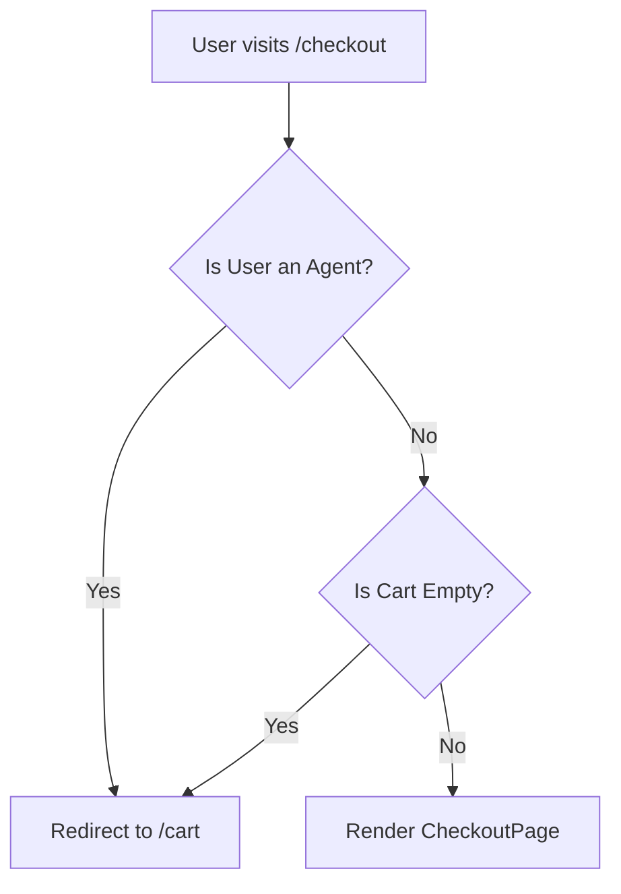

# Design Doc: Checkout Guard (Prevent Empty Cart)

## Overview
This design aims to prevent users from accessing the checkout page if their cart is empty. It also consolidates the existing logic that prevents agents from accessing the checkout.

## Architecture
We will update the existing `PreventAgentCheckoutRoute` guard to include a check for the shopping cart's items.

## Components to Modify
1.  `src/auth/PreventAgentCheckoutRoute.tsx`: Update to check `cart.items.length`.
2.  `src/App.tsx`: (Optional) Rename the guard if desired, though keeping the name is fine for now to minimize changes.

## Logic Flow

## Data Flow
-   **Source:** Redux State (`state.cart.items`, `state.auth.user`, `state.auth.isAuth`).
-   **Output:** `Navigate` component or `Outlet`.

## Testing
1.  Add items to cart, visit `/checkout` -> Success.
2.  Clear cart, visit `/checkout` manually -> Redirected to `/cart`.
3.  Login as agent, visit `/checkout` -> Redirected to `/cart`.
