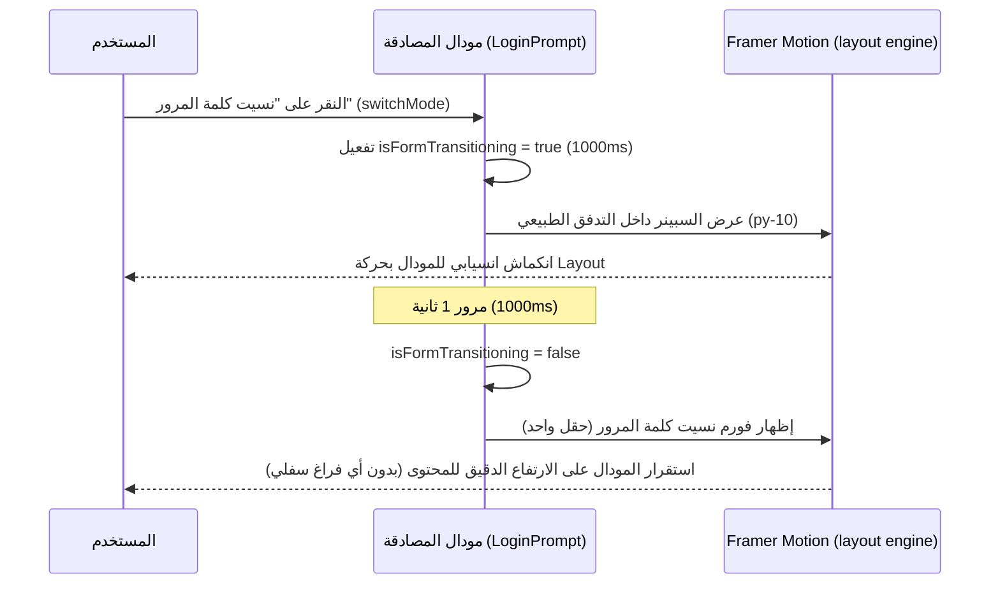

# 📑 تقرير فني وتقني: الارتفاع الديناميكي للمودال مع سبينر الانتقال السلس (مدة 1 ثانية)

**التاريخ**: 4 سبتمبر 2026  
**المشروع**: هارفيستا (Harvesta)  
**نطاق التعديل**: واجهة المستخدم وحركات الانتقال الذكية (UI & Modal Micro-interactions)

---

## 💡 الجزء الأول: الشرح النظري وتجربة المستخدم (Theoretical & UX Overview)

### 1. الدافع والتوازن بين السلاسة البصرية وتناسق الأبعاد (Visual Flow vs Content Fit)
- **المشكلة السابقة**:
  - كان المودال سابقاً محكوماً بارتفاع ثابت كبير (`min-h-[300px]`) مما خلف فراغاً سفلياً ضخماً غير مستغل ومشوهاً في واجهة "نسيت كلمة المرور".
  - تم إزالة الفراغ السفلي بالكامل ليصبح طول المودال متجاوباً بحسب المحتوى (Content-Driven Height).
  - ولكن عند التبديل اللحظي التام بين التبويبات بدون أي عنصر انتقالي وسيط، كان ينقص المستخدم الإحساس بالانسيابية الفاخرة (Micro-interaction Polish) التي يمنحها مؤشر التحميل (Spinner) أثناء التبديل بين الشاشات.
- **الحل المبتكر والتجربة المستهدفة**:
  - **الجمع المثالي بين الاثنين**:
    1. **استعادة السبينر الانتقالي الأنيق مع مدة واضحة (1 ثانية كاملة)**: عند التبديل بين تسجيل الدخول، أو إنشاء الحساب، أو نسيت كلمة المرور، يظهر مؤشر تحميل دوار ناعم مع نبض للنص التوضيحي لمدة ثانية كاملة (`1000ms`) ليعطي إحساساً تفاعلياً راقياً، مريحاً للعين، وغير متسرع.
    2. **حجم ديناميكي بنسبة 100% بدون أي مساحة فارغة ميتة**: تم تصميم السبينر ليتواجد ضمن تدفق الصفحة الطبيعي (Normal Flow) وليس كعنصر مطلق (`absolute`)، مع إزالة `min-h-[300px]` نهائياً، بحيث يستقر المودال في شاشة "نسيت كلمة المرور" بحجم ملموم ومضبوط تماماً على قدر الحقل الوحيد والزر، ويتمدد بسلاسة في "إنشاء حساب" و "تسجيل الدخول".

---

## 🔬 الجزء الثاني: التشريح والشرح التقني المعمق (In-Depth Technical Architecture & Code Breakdown)



---

### 1. تفصيل التعديلات التقنية في `resources/frontend/src/components/LoginPrompt.tsx`:

#### أ. إعادة هندسة موضع السبينر في شجرة الـ DOM (Flow-based vs Absolute)
- **الخلل القديم**:
  في السابق، كان السبينر يتم وضعه عبر:
  ```tsx
  // الكود القديم المسبب للمشكلة:
  <div className="absolute inset-0 flex flex-col items-center justify-center p-6">
  ```
  ولأن `absolute` يخرج العنصر من حسابات تدفق الارتفاع في المتصفح، كان المطور مجبراً على وضع `min-h-[300px]` على الحاوية الأب حتى لا ينهار الارتفاع، مما جعل الـ `300px` تلتصق بالنافذة طوال الوقت حتى بعد انتهاء السبينر!
- **الهندسة الجديدة**:
  ```tsx
  // الكود الجديد المطور:
  <motion.div
    key="form-transition-spinner"
    className="py-10 flex flex-col items-center justify-center text-center"
    initial={{ opacity: 0, scale: 0.94 }}
    animate={{ opacity: 1, scale: 1 }}
    exit={{ opacity: 0, scale: 0.94 }}
    transition={{ duration: 0.15 }}
  >
    <div className="w-10 h-10 rounded-full border-3 border-[#B12C2E] border-t-transparent animate-spin mb-3"></div>
    <p className="text-gray-500 dark:text-slate-400 text-sm animate-pulse font-medium">
      ...
    </p>
  </motion.div>
  ```
  هنا، السبينر يعيش في الـ Flow الطبيعي مع مسافة رأسية متناسقة (`py-10`). لا يحتاج لأي `min-h` إجباري على الحاوية الأم، وعندما ينتهي ويظهر الفورم المستهدف، يأخذ الفورم حجمه الحقيقي دون بقاء أي فراغ إضافي.

#### ب. تعديل مدة الانتقال إلى 1 ثانية (1000ms)
- في دالة `switchMode`:
  ```tsx
  const switchMode = (target: 'login' | 'register' | 'forgot-password') => {
    setIsFormTransitioning(true);
    setError(null);
    setFieldErrors({});
    setForgotPasswordSuccess(null);
    setPopupType(target);

    setTimeout(() => {
      setIsFormTransitioning(false);
    }, 1000); // مدة 1 ثانية كاملة
  };
  ```
  تم ضبط التوقيت عند `1000ms` (ثانية كاملة) بناءً على رغبة المستخدم لمنح شعور واضح بالهدوء والانسيابية عند التبديل، ليعطي وقتاً كافياً للعين لملاحظة التحول وتجهيز الفورم التالي.

---

### 2. التحقق النهائي من الشاشات الثلاث (Verification Across All 3 Views):
1. **شاشة "نسيت كلمة المرور"**: سبينر لمدة 1 ثانية ⬅️ ظهور فوري للحقل والزر مع حجم متناسق ومضبوط، مع تلاشي الفراغ السفلي الميت نهائياً.
2. **شاشة "تسجيل الدخول"**: سبينر لمدة 1 ثانية ⬅️ ظهور الحقلين ورابط نسيت كلمة المرور وزر الدخول بارتفاع مخصص ومريح.
3. **شاشة "إنشاء حساب جديد"**: سبينر لمدة 1 ثانية ⬅️ تمدد المودال بسلاسة ليستوعب الحقول الأربعة كاملة وزر التسجيل.
4. **دعم الثيمين (Light & Dark)**: ألوان السبينر والحدود متوافقة مع متطلبات الثيمين في هارفيستا.
